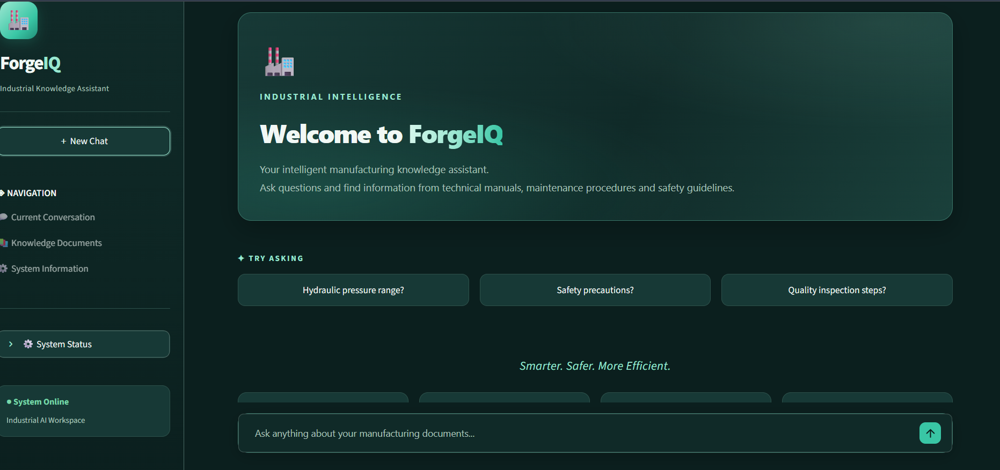
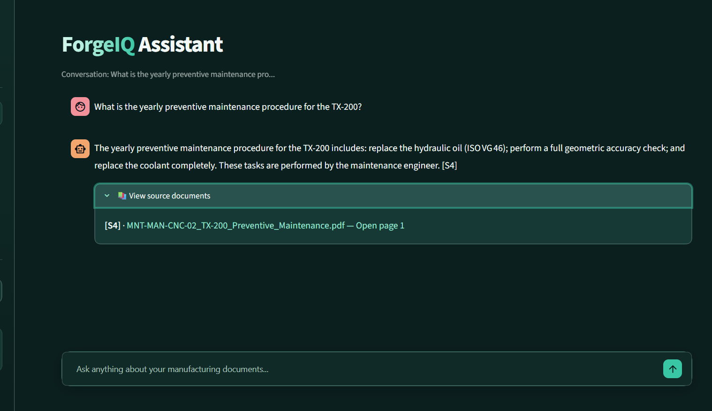
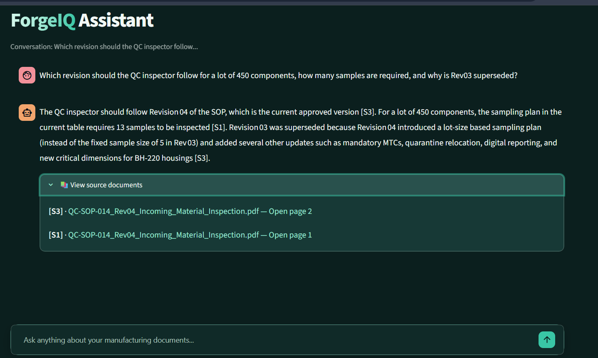
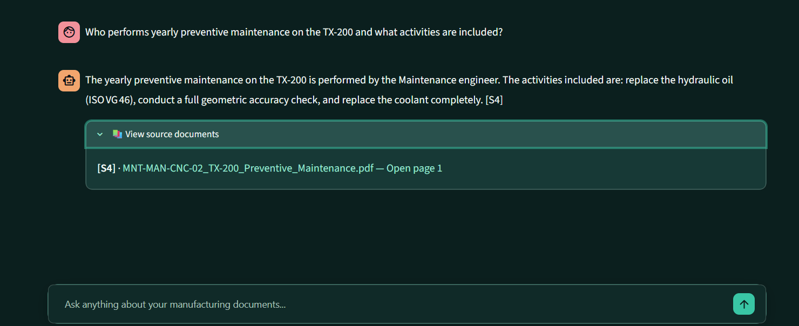
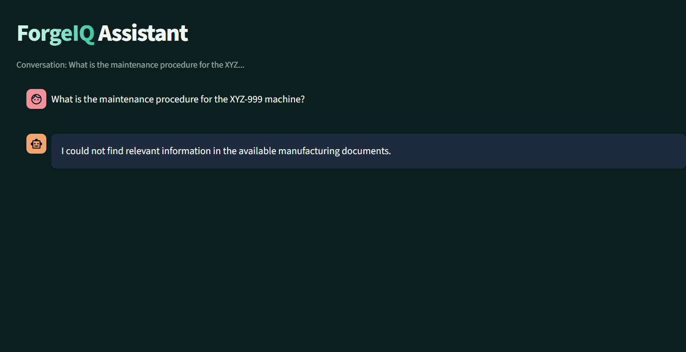
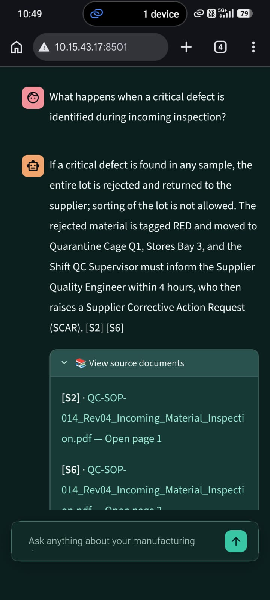
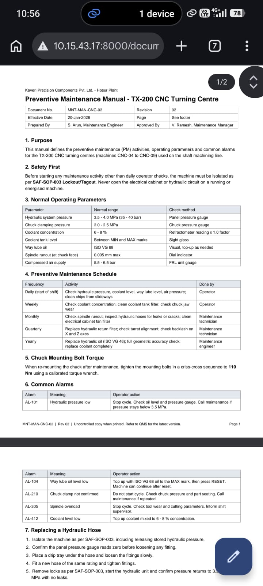
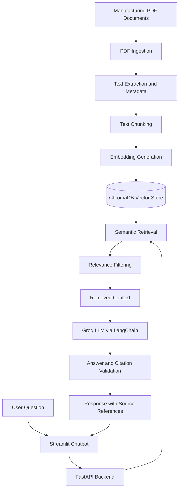

# Manufacturing SOP AI Copilot

An AI-powered Manufacturing SOP Copilot built using **Retrieval-Augmented Generation (RAG)** to help manufacturing employees retrieve accurate information from technical manuals, quality inspection procedures, preventive maintenance documents, and safety instructions.

The application allows users to ask questions in natural language and receive context-based answers with supporting document references and page numbers.

## Project Overview

Manufacturing employees often need to search through multiple PDF documents to find specific technical information. Manually searching lengthy documents can be time-consuming.

Manufacturing SOP AI Copilot addresses this problem through a RAG-based chatbot that:

- Extracts information from manufacturing PDF documents.
- Retrieves relevant passages using semantic search.
- Generates context-grounded answers using an LLM.
- Displays supporting source documents and page references.
- Refuses to answer when sufficient information is unavailable.

## Key Features

- **PDF Document Processing:** Extract text and page metadata from PDF documents.
- **Semantic Search:** Retrieve relevant information using Sentence Transformers.
- **Vector Database:** Store and search document embeddings using ChromaDB.
- **RAG Pipeline:** Generate answers using LangChain and Groq.
- **Source Citations:** Display supporting PDF documents and page references.
- **Revision Handling:** Exclude superseded SOP revisions from normal retrieval.
- **Relevance Filtering:** Filter retrieved passages using a similarity-distance threshold.
- **No-Answer Handling:** Avoid generating unsupported answers.
- **Citation Validation:** Validate generated citation IDs against retrieved passages.
- **Chatbot Interface:** Interact with manufacturing documents through Streamlit.
- **REST API:** Serve question-answering functionality through FastAPI.
- **Mobile Access:** Access the chatbot from another device on the same local Wi-Fi network.

## Application Screenshots

### 1. Chatbot Interface



### 2. RAG Answer with Source Citation



### 3. Quality Inspection



### 4. Yearly Preventive Maintenance



### 5. Unsupported Question Handling



### 6. Mobile Chatbot Deployment



### 7. Mobile PDF Source Access



## Technology Stack

| Component | Technology |
|---|---|
| Programming Language | Python 3.12 |
| Backend | FastAPI |
| Frontend | Streamlit |
| LLM Provider | Groq |
| LLM Integration | LangChain |
| Embedding Model | all-MiniLM-L6-v2 |
| Vector Database | ChromaDB |
| PDF Processing | PyMuPDF |
| Environment Management | python-dotenv |
| Testing | pytest |

## System Architecture



## Project Structure

```text
manufacturing-sop-copilot/
│
├── backend/
│   ├── __init__.py
│   ├── main.py
│   ├── ingestion.py
│   ├── chunking.py
│   ├── vector_store.py
│   ├── retrieval.py
│   ├── rag_pipeline.py
│   ├── test_groq.py
│   └── test_retrieval.py
│
├── frontend/
│   └── app.py
│
├── documents/
│   ├── QC-SOP-014_Rev03_Incoming_Material_Inspection.pdf
│   ├── QC-SOP-014_Rev04_Incoming_Material_Inspection.pdf
│   ├── SAF-SOP-003_Lockout_Tagout_Procedure.pdf
│   └── MNT-MAN-CNC-02_TX-200_Preventive_Maintenance.pdf
│
├── screenshots/
│   ├── 01_home.png
│   ├── 02_rag_answer.png
│   ├── 03_quality_inspection.png
│   ├── 04_yearly_maintenance.png
│   ├── 05_no_answer.png
│   ├── 06_mobile_chatbot.jpeg
│   └── 07_mobile_pdf.jpeg
│
├── tests/
│   └── test_rag_pipeline.py
│
├── vectorstore/
├── venv/
├── .env
├── .gitignore
├── requirements.txt
├── USER_JOURNEY.md
├── AI_CRITIQUE.md
├── FINAL_REFLECTION.md
└── README.md
```

Note: `.env`, `venv/`, and `vectorstore/` are local runtime resources and should remain excluded from Git.

## RAG Workflow

1. **Document Ingestion:** Extract text and page metadata from manufacturing PDF documents using PyMuPDF.
2. **Text Chunking:** Divide extracted content into smaller overlapping passages.
3. **Embedding Generation:** Convert document passages into numerical embeddings using Sentence Transformers.
4. **Vector Storage:** Store active document embeddings in ChromaDB.
5. **Semantic Retrieval:** Retrieve relevant passages based on the user's question.
6. **Relevance Filtering:** Filter retrieved passages using a configured distance threshold.
7. **Answer Generation:** Pass the retrieved context and question to the Groq LLM through LangChain.
8. **Citation Validation:** Validate generated citation IDs against retrieved passages.
9. **Response Generation:** Display the answer and supporting source references in Streamlit.

## Installation and Setup

### 1. Clone the repository

```bash
git clone https://github.com/Rajeshr318/manufacturing-sop-copilot.git

cd manufacturing-sop-copilot
```

### 2. Create a virtual environment

```bash
python -m venv venv
```

Activate it on Windows:

```powershell
venv\Scripts\Activate.ps1
```

### 3. Install dependencies

```bash
python -m pip install -r requirements.txt
```

### 4. Configure environment variables

Create a `.env` file in the project root by copying the provided template:

```powershell
Copy-Item .env.example .env
```

Open `.env` and configure the following variables:

```env
GROQ_API_KEY=your_groq_api_key
GROQ_MODEL=openai/gpt-oss-20b
OLLAMA_MODEL=qwen2.5-coder:3b
OLLAMA_BASE_URL=http://127.0.0.1:11434
ENABLE_OLLAMA_FALLBACK=true
```

 Obtain a Groq API key from the Groq developer console.
 Install Ollama and pull the configured model if you want to use the local fallback.
 Set `ENABLE_OLLAMA_FALLBACK=false` if you do not want to use Ollama.

**Important:** Never commit your actual API key or `.env` file to GitHub.

### 5. Add manufacturing documents

Place the required PDF documents inside the `documents/` directory.

The superseded QC-SOP-014 Rev03 document is retained for revision-handling tests but excluded from normal retrieval.

### 6. Process documents

Run the processing modules in order:

```bash
python -m backend.ingestion

python -m backend.chunking

python -m backend.vector_store
```

These steps extract PDF text, create overlapping chunks, generate embeddings, and store active document chunks in ChromaDB.

## Running the Application

### Start FastAPI Backend

Open the first terminal:

```bash
python -m uvicorn backend.main:app --reload
```

Backend URL:

```text
http://127.0.0.1:8000
```

Swagger API documentation:

```text
http://127.0.0.1:8000/docs
```

Health endpoint:

```text
http://127.0.0.1:8000/health
```

### Start Streamlit Frontend

Open a second terminal:

```bash
streamlit run frontend/app.py
```

The chatbot will open in your browser.

## Example Questions

1. What is the recommended coolant concentration for the TX-200 CNC machine?
2. What does AL-104 indicate, and what action should the operator take?
3. Who is authorized to remove a personal Lockout/Tagout lock?
4. What is the BH-220 outer diameter tolerance?
5. How frequently should spindle runout be checked?

### Additional Custom Test Questions

1. What safety steps are required before TX-200 maintenance?
2. What is the normal hydraulic pressure range for TX-200?
3. What happens when a critical defect is identified in an incoming material lot?
4. What is the required torque for chuck mounting bolts?
5. What is the monthly electricity consumption of the factory?

The fifth question is intentionally unsupported by the available documents and should trigger the no-answer response.

## Testing and Evaluation

The application was evaluated using five assignment sample questions and five additional custom questions.

Testing covered:

- Machine operating parameters.
- Preventive maintenance schedules.
- Safety and Lockout/Tagout procedures.
- Quality inspection requirements.
- Document revision handling.
- Source citation generation.
- Unsupported question handling.

Automated tests cover:

- Valid answer generation with valid citations.
- Unsupported questions returning the no-answer response.
- Invalid LLM JSON returning the no-answer response.

Run automated tests using:

```bash
python -m pytest tests/ -v
```

**Recorded automated test result:** 8 tests passed.

Manual testing also verified the application through the Streamlit interface.

## Local Network and Mobile Deployment

The application was successfully tested using a mobile hotspot, allowing a mobile phone to access the chatbot running on the development laptop.

### 1. Start FastAPI

```bash
python -m uvicorn backend.main:app --host 0.0.0.0 --port 8000
```

### 2. Start Streamlit

```bash
streamlit run frontend/app.py --server.address 0.0.0.0 --server.port 8501
```

### 3. Find the host computer's IPv4 address

```powershell
ipconfig
```

### 4. Configure network URLs

Configure the frontend API endpoint and PDF source links to use the host computer's local IPv4 address instead of `127.0.0.1`.

For example:

```text
http://YOUR_LOCAL_IP:8000/ask
http://YOUR_LOCAL_IP:8000/documents/
```

### 5. Access from a mobile device

Connect the laptop and mobile phone to the same Wi-Fi network or mobile hotspot.

Open the following address in the mobile browser:

```text
http://YOUR_LOCAL_IP:8501
```

The mobile deployment was tested successfully, including chatbot interaction and opening PDF source documents.

Note: The host computer must remain running, and the required ports must be allowed through Windows Firewall. The local IP address may change when connecting to another network.

## Limitations

- Answer quality depends on the completeness and quality of the uploaded documents.
- Semantic retrieval may miss relevant passages.
- Similarity-distance thresholds require further evaluation across a larger test dataset.
- Citation ID validation does not independently prove that every cited passage supports every answer detail.
- Complex PDF tables may require additional structural preprocessing.
- Updated SOP documents require manual reprocessing and indexing.
- The application is not a replacement for official SOPs or authorized safety and maintenance decisions.

## Future Improvements

- Implement hybrid search combining keyword and semantic retrieval.
- Improve table-aware PDF extraction and chunking.
- Add stronger citation and answer verification.
- Implement automatic document revision management.
- Support additional document formats.
- Add user authentication and role-based access control.
- Improve deployment configuration and security.

## Safety Disclaimer

This application is intended to assist users in retrieving information from manufacturing documents.

Always verify critical instructions against the latest approved SOP and follow authorized safety, quality, and maintenance procedures.

## Author

Developed as a Generative AI and Retrieval-Augmented Generation project using Python, LangChain, FastAPI, Streamlit, ChromaDB, Sentence Transformers, and Groq.
