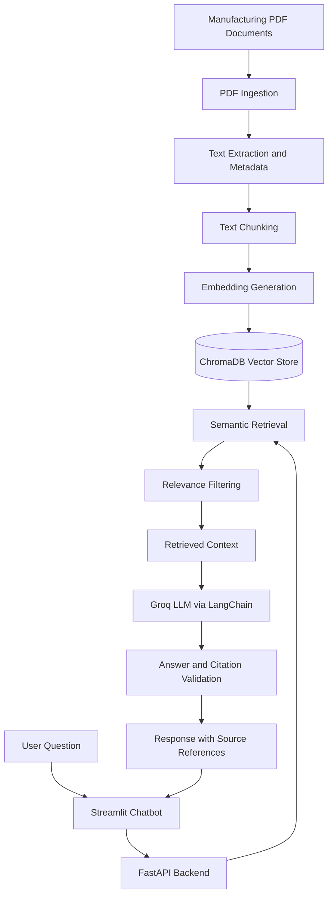

# Manufacturing SOP AI Copilot – ForgeIQ

An AI-powered Manufacturing SOP Copilot built using **Retrieval-Augmented Generation (RAG)** to help manufacturing employees retrieve accurate information from technical manuals, quality inspection procedures, preventive maintenance documents, and safety instructions.

The application allows users to ask questions in natural language and receive context-grounded answers with supporting document references and page numbers.

## Project Overview

Manufacturing employees often need to search through multiple PDF documents to find specific technical information. Manually searching lengthy documents can be time-consuming, especially when supervisors need information quickly during their shifts.

ForgeIQ addresses this problem through a RAG-based chatbot that:

- Extracts information from manufacturing PDF documents.
- Retrieves relevant passages using semantic search.
- Generates context-grounded answers using an LLM.
- Displays supporting source documents and page references.
- Refuses to answer when sufficient information is unavailable.

## Key Features

- **PDF Document Processing:** Extract text and page metadata from PDF documents.
- **Semantic Search:** Retrieve relevant information using Sentence Transformers.
- **Vector Database:** Store and search document embeddings using ChromaDB.
- **RAG Pipeline:** Generate answers using LangChain and Groq.
- **Source Citations:** Display supporting PDF documents and page references.
- **Revision Handling:** Exclude superseded SOP revisions from normal retrieval.
- **Relevance Filtering:** Filter retrieved passages using a similarity-distance threshold.
- **No-Answer Handling:** Avoid generating unsupported answers.
- **Citation Validation:** Validate generated citation IDs against retrieved passages.
- **Chatbot Interface:** Interact with manufacturing documents through Streamlit.
- **REST API:** Serve question-answering functionality through FastAPI.
- **Mobile Access:** Access the chatbot from another device on the same local Wi-Fi network.

## Application Screenshots

### 1. Chatbot Interface


### 2. RAG Answer with Source Citation


### 3. Quality Inspection


### 4. Yearly Preventive Maintenance


### 5. Unsupported Question Handling


### 6. Mobile Chatbot Deployment


### 7. Mobile PDF Source Access


## Technology Stack

| Component | Technology |
|---|---|
| Programming Language | Python 3.12 |
| Backend | FastAPI |
| Frontend | Streamlit |
| LLM Provider | Groq |
| Local LLM Fallback | Ollama |
| LLM Integration | LangChain |
| Embedding Model | all-MiniLM-L6-v2 |
| Vector Database | ChromaDB |
| PDF Processing | PyMuPDF |
| Environment Management | python-dotenv |
| Testing | pytest |

## System Architecture



## Project Structure

```text
manufacturing-sop-copilot/
│
├── backend/
│   ├── __init__.py
│   ├── main.py
│   ├── ingestion.py
│   ├── chunking.py
│   ├── vector_store.py
│   ├── retrieval.py
│   ├── rag_pipeline.py
│   ├── test_groq.py
│   └── test_retrieval.py
│
├── frontend/
│   └── app.py
│
├── documents/
│   ├── QC-SOP-014_Rev03_Incoming_Material_Inspection.pdf
│   ├── QC-SOP-014_Rev04_Incoming_Material_Inspection.pdf
│   ├── SAF-SOP-003_Lockout_Tagout_Procedure.pdf
│   └── MNT-MAN-CNC-02_TX-200_Preventive_Maintenance.pdf
│
├── screenshots/
│   ├── 01_home.png
│   ├── 02_rag_answer.png
│   ├── 03_quality_inspection.png
│   ├── 04_yearly_maintenance.png
│   ├── 05_no_answer.png
│   ├── 06_mobile_chatbot.jpeg
│   └── 07_mobile_pdf.jpeg
│
├── tests/
│   └── test_rag_pipeline.py
│
├── .streamlit/
│   └── config.toml
│
├── .env.example
├── .gitignore
├── requirements.txt
├── USER_JOURNEY.md
├── AI_CRITIQUE.md
├── FINAL_REFLECTION.md
├── THINKING.md
└── README.md
```

**Note:** The `vectorstore/` directory and Python virtual environment are generated locally during setup. The actual `.env` file contains private configuration and must not be committed to GitHub. These are excluded using `.gitignore`.

## RAG Workflow

1. **Document Ingestion:** Extract PDF text and page metadata using PyMuPDF.
2. **Text Chunking:** Divide extracted content into smaller overlapping passages.
3. **Embedding Generation:** Convert document passages into numerical embeddings using Sentence Transformers.
4. **Vector Storage:** Store active document embeddings in ChromaDB.
5. **Semantic Retrieval:** Retrieve relevant passages based on the user's question.
6. **Relevance Filtering:** Filter retrieved passages using a configured distance threshold.
7. **Answer Generation:** Pass the retrieved context and question to the Groq LLM through LangChain.
8. **Citation Validation:** Validate generated citation IDs against retrieved passages.
9. **Response Generation:** Display the answer and supporting source references in Streamlit.

The application also supports a configurable Ollama fallback when enabled.

## Installation and Setup

### 1. Clone the repository

```bash
git clone https://github.com/Rajeshr318/manufacturing-sop-copilot.git

cd manufacturing-sop-copilot
```

### 2. Create a virtual environment

```bash
python -m venv venv
```

Activate it on Windows PowerShell:

```powershell
.\venv\Scripts\Activate.ps1
```

### 3. Install dependencies

```bash
python -m pip install -r requirements.txt
```

### 4. Configure environment variables

Create a local `.env` file using the provided template:

```powershell
Copy-Item .env.example .env
```

Open `.env` and configure the required values:

```env
GROQ_API_KEY=your_groq_api_key
GROQ_MODEL=openai/gpt-oss-20b
OLLAMA_MODEL=qwen2.5-coder:3b
OLLAMA_BASE_URL=http://127.0.0.1:11434
ENABLE_OLLAMA_FALLBACK=true
```

Obtain a Groq API key from the Groq developer console.

For local fallback, install Ollama and pull the configured model. Set `ENABLE_OLLAMA_FALLBACK=false` if you do not want to use the local fallback.

**Important:** Never commit your actual API key or `.env` file to GitHub.

### 5. Add manufacturing documents

Place the required PDF documents inside the `documents/` directory.

The superseded QC-SOP-014 Rev03 document is retained for revision-handling tests but excluded from normal retrieval.

### 6. Process documents

Run the processing modules in order:

```bash
python -m backend.ingestion

python -m backend.chunking

python -m backend.vector_store
```

These steps extract PDF text, create overlapping chunks, generate embeddings, and store active document chunks in ChromaDB.

## Running the Application

### Start FastAPI Backend

Open the first terminal:

```powershell
python -m uvicorn backend.main:app --host 127.0.0.1 --port 8000
```

Backend URL:

```text
http://127.0.0.1:8000
```

Swagger API documentation:

```text
http://127.0.0.1:8000/docs
```

Health endpoint:

```text
http://127.0.0.1:8000/health
```

### Start Streamlit Frontend

Open a second terminal, activate the virtual environment, and run:

```powershell
streamlit run frontend/app.py
```

The chatbot will open in your browser.

Application URL:

```text
http://localhost:8501
```

## Example Questions

The following questions are based on the provided sample manufacturing documents:

1. What is the recommended coolant concentration for the TX-200 CNC machine?
2. What does AL-104 indicate, and what action should the operator take?
3. Who is authorized to remove a personal Lockout/Tagout lock?
4. What is the BH-220 outer diameter tolerance?
5. How frequently should spindle runout be checked?

## Additional Custom Test Questions and Answers

The following five questions were created to evaluate ForgeIQ beyond the provided sample questions. The answers below reflect the application's actual test responses.

### 1. What safety steps are required before TX-200 maintenance?

**ForgeIQ Answer:**

Before performing maintenance:

- Inform affected personnel.
- Follow the normal machine shutdown procedure.
- Isolate all energy sources, including the main electrical isolator, compressed air, and hydraulic power unit.
- Apply a personal lock and danger tag.
- Release stored energy.
- Verify zero-energy status before beginning work.

### 2. What is the normal hydraulic pressure range for TX-200?

**ForgeIQ Answer:**

The normal hydraulic pressure range for the TX-200 is **3.5–4.0 MPa (35–40 bar)**.

**Source:** MNT-MAN-CNC-02_TX-200_Preventive_Maintenance.pdf, Page 1.

### 3. What happens when a critical defect is identified in an incoming material lot?

**ForgeIQ Answer:**

The complete lot must be rejected and returned to the supplier. Sorting is not permitted for critical defects.

### 4. What is the required torque for chuck mounting bolts?

**ForgeIQ Answer:**

"I could not find relevant information in the available manufacturing documents."

The application correctly avoids generating an unsupported torque value.

### 5. What is the monthly electricity consumption of the factory?

**ForgeIQ Answer:**

"I could not find relevant information in the available manufacturing documents."

The provided manufacturing documents do not contain factory electricity consumption data.

Questions 4 and 5 demonstrate ForgeIQ's no-answer handling when the requested information is unavailable.

## Testing and Evaluation

The application was evaluated using five assignment sample questions and five additional custom questions.

Testing covered:

- Machine operating parameters.
- Preventive maintenance schedules.
- Safety and Lockout/Tagout procedures.
- Quality inspection requirements.
- Document revision handling.
- Source citation generation.
- Unsupported question handling.

### Automated Tests

Automated tests cover:

- Valid answer generation with valid citations.
- Unsupported questions returning the no-answer response.
- Invalid LLM JSON returning the no-answer response.
- Invalid citation handling.
- LLM and retrieval failures.
- Empty question handling.
- Complex answer-generation failure handling.

Run the automated tests:

```powershell
python -m pytest tests/ -v
```

**Recorded automated test result: 8 tests passed.**

Manual testing also verified the application through the Streamlit interface.

## Local Network and Mobile Deployment

The application was successfully tested on a mobile device connected to the same local network as the development laptop.

### 1. Start FastAPI

Run the backend so that other devices on the local network can access it:

```powershell
python -m uvicorn backend.main:app --host 0.0.0.0 --port 8000
```

### 2. Find the host computer's IPv4 address

Open another PowerShell terminal:

```powershell
ipconfig
```

Identify the IPv4 address of the active Wi-Fi or hotspot adapter.

For example:

```text
10.15.43.17
```

Your actual IP address may be different.

### 3. Configure and start Streamlit

Open another PowerShell terminal, activate the virtual environment, and set the backend URL using the laptop's IPv4 address:

```powershell
$env:API_BASE_URL = "http://YOUR_LOCAL_IP:8000"
```

Start Streamlit:

```powershell
streamlit run frontend/app.py --server.address 0.0.0.0 --server.port 8501
```

Replace `YOUR_LOCAL_IP` with the actual IPv4 address of your laptop.

### 4. Access ForgeIQ from a mobile device

Connect the laptop and mobile phone to the same Wi-Fi network or mobile hotspot.

Open the following address in the mobile browser:

```text
http://YOUR_LOCAL_IP:8501
```

For example:

```text
http://10.15.43.17:8501
```

The mobile deployment was successfully tested, including chatbot interaction and opening PDF source documents.

**Important notes:**

- The host computer must remain running.
- Both devices must be connected to the same local network.
- Windows Firewall must allow the required ports.
- The local IP address may change when connecting to another network.
- The `API_BASE_URL` environment variable must be configured again when starting Streamlit in a new terminal session.

## Limitations

- Answer quality depends on the completeness and quality of the available documents.
- Semantic retrieval may miss relevant passages.
- Similarity-distance thresholds require further evaluation across a larger test dataset.
- Citation ID validation does not independently prove that every cited passage supports every answer detail.
- Complex PDF tables may require additional structural preprocessing.
- Updated SOP documents require manual reprocessing and indexing.
- The application is not a replacement for official SOPs or authorized safety and maintenance decisions.

## Future Improvements

- Implement hybrid search combining keyword and semantic retrieval.
- Improve table-aware PDF extraction and chunking.
- Add stronger citation and answer verification.
- Implement automatic document revision management.
- Support additional document formats.
- Add user authentication and role-based access control.
- Improve deployment configuration and security.

## Safety Disclaimer

This application is intended to assist users in retrieving information from manufacturing documents.

Always verify critical instructions against the latest approved SOP and follow authorized safety, quality, and maintenance procedures.

## Author

Developed as a Generative AI and Retrieval-Augmented Generation project using Python, LangChain, FastAPI, Streamlit, ChromaDB, Sentence Transformers, Groq, and Ollama.